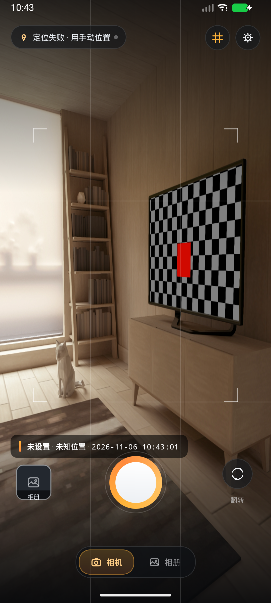
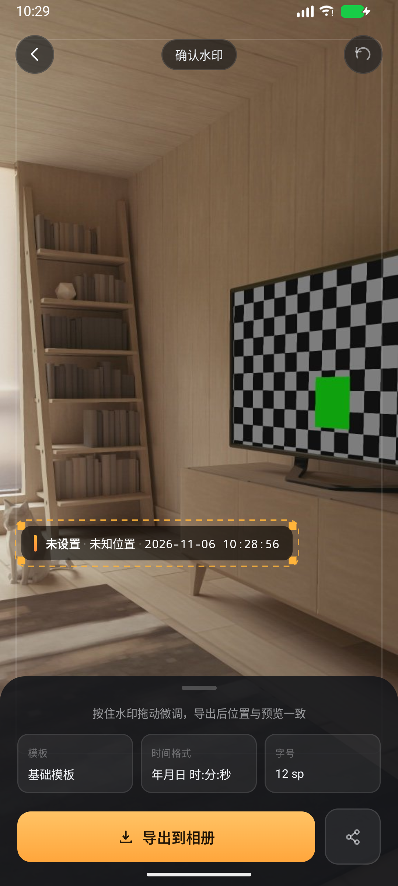
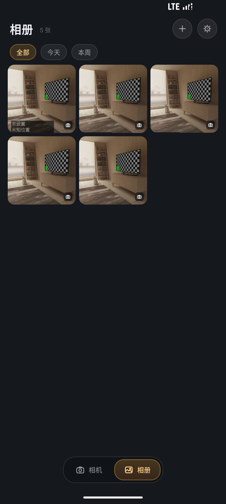
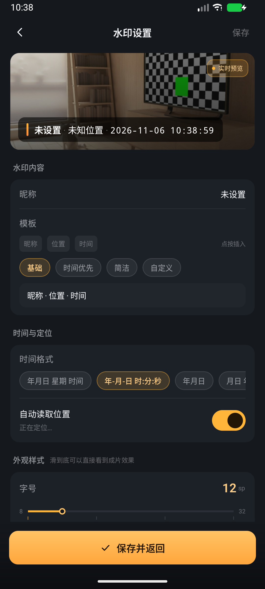
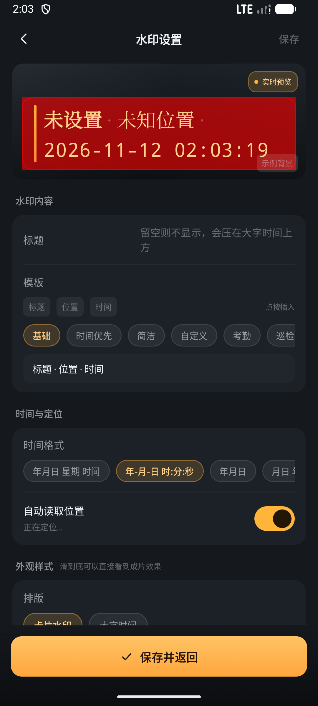
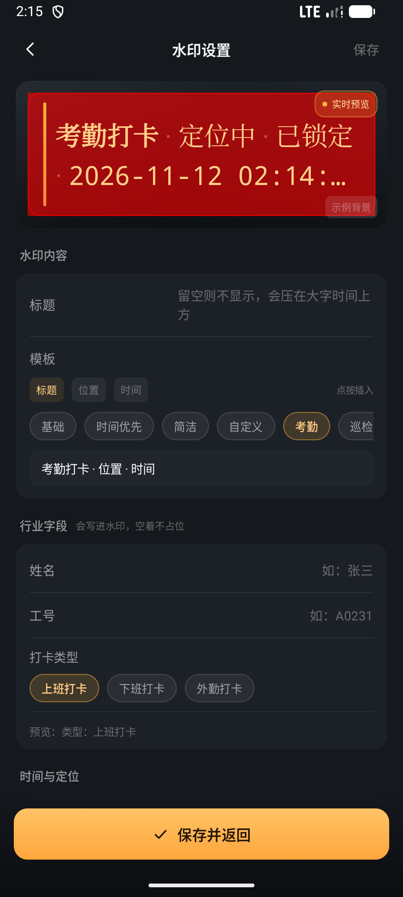
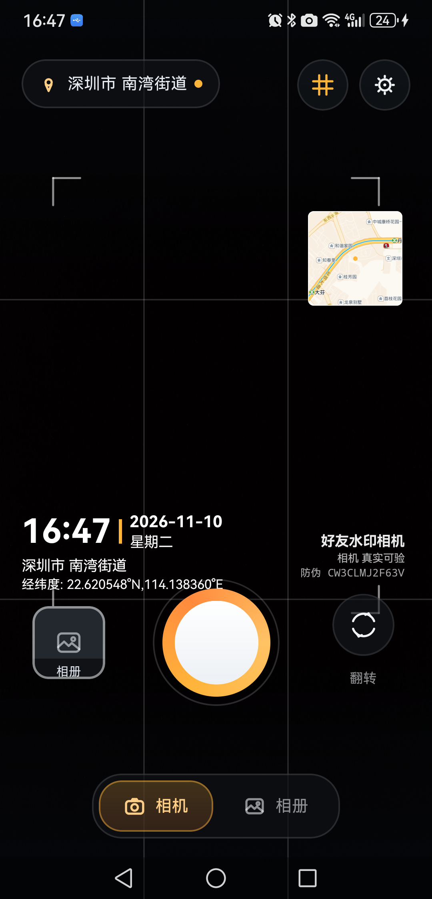
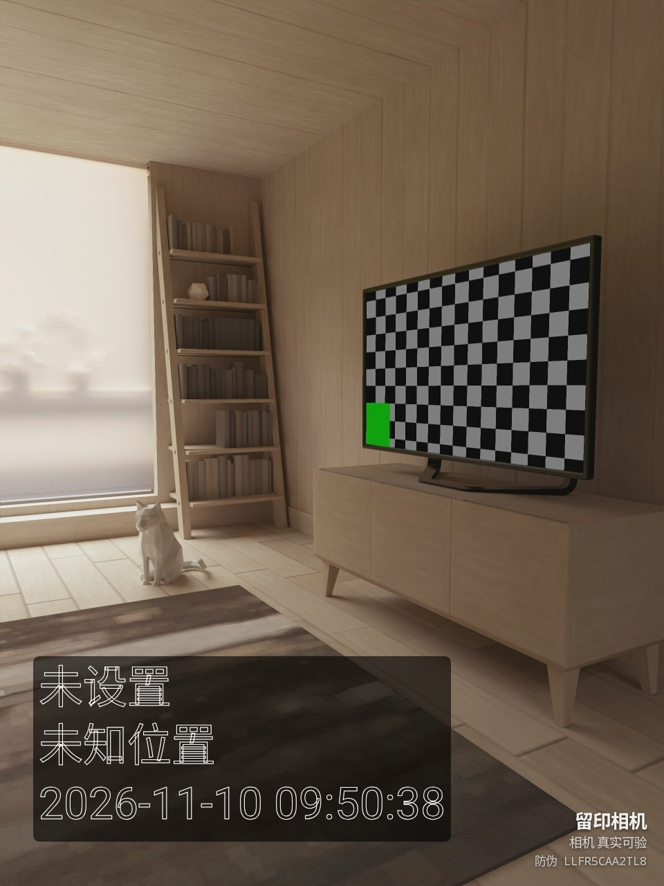

<p align="center">
  
</p>

<h1 align="center">留印相机</h1>

<p align="center">
  一款功能丰富的 <b>Android 水印相机</b> 应用，为每一张照片留下真实的时间与地点印记。<br/>
  支持多种行业模板、防伪验真、实时定位、天气信息附加等完整功能，<br/>
  面向打卡考勤、工程巡检、物资验收、旅行记录等多种实际使用场景。
</p>

<p align="center">
  
  
  
  
</p>

---

## 📱 界面预览

<table>
  <tr>
    <td align="center"><br/><sub>📷 相机取景</sub></td>
    <td align="center"><br/><sub>✏️ 水印确认</sub></td>
    <td align="center"><br/><sub>🖼️ 相册</sub></td>
    <td align="center"><br/><sub>⚙️ 设置</sub></td>
  </tr>
  <tr>
    <td align="center"><br/><sub>🏗️ 行业模板</sub></td>
    <td align="center"><br/><sub>📋 巡检字段</sub></td>
    <td align="center"><br/><sub>🌍 地图水印</sub></td>
    <td align="center"><br/><sub>🎴 卡片导出</sub></td>
  </tr>
</table>

| 页面 | 说明 |
|------|------|
| 📷 **相机取景** | 主界面：实时取景 + 水印预览 + 拍摄控件 |
| ✏️ **水印确认** | 拍照后预览成片、拖拽调水印位置、导出 |
| 🖼️ **相册** | 所有导出水印照片的画廊 |
| ⚙️ **设置** | 水印样式、模板、附加信息、拍摄参数等 |
| 🔍 **验真** | 输入防伪码校验照片真实性 |

---

## ✨ 核心功能

### 📸 相机拍摄
- 实时取景预览（CameraX 后摄 / 前摄翻转）
- 出片比例选择：4:3 / 16:9 / 1:1 / 全屏
- 定时拍照（3s / 5s / 10s）
- 连拍模式（单张 / 3 张 / 5 张）
- 闪光灯控制（关闭 / 常亮 / 自动）
- 音量键当快门、捏合手势变焦
- 水平仪参考线、三分构图网格线

### 🏷️ 水印自定义
- **4 种样式**：纯色背景 / 圆角矩形 / 胶囊圆角 / 文字描边
- **4 种背景填充**：纯色 / 透明 / 圆角边框 / 渐变
- **5 种位置**：左上 / 右上 / 左下 / 右下 / 居中
- **5 种字体**：默认 / 衬线体 / 等宽体 / 无衬线 / 紧凑
- **6 种时间格式** 和自定义格式
- **拖拽微调** 水印位置、大小滑块调节
- 自定义水印颜色 + 自定义取色器

### 🏗️ 行业模板库

| 模板 | 说明 | 结构化字段 |
|------|------|-----------|
| **基础模板** | 通用水印 | 标题 · 位置 · 时间 |
| **时间优先** | 时间信息优先展示 | 时间 · 位置 · 标题 |
| **简洁版** | 精简信息 | 位置 · 时间 |
| **考勤打卡** | 上班/下班签到 | 姓名、工号、打卡类型 |
| **工程巡检** | 设备安全检查 | 巡检点位、设备运行/安全防护/环境卫生、隐患说明 |
| **物资采购** | 采购记录 | 物资名称、规格型号、数量、单价 |
| **材料验收** | 进场材料验收 | 材料名称、规格/批号、数量、验收结论 |
| **劳务用工** | 工时统计 | 工种、出勤人数、人均工时、工时单价 |
| **微商水印** | 商品展示 | 商品名称、价格、卖点/优惠 |
| **旅行记录** | 旅行打卡 | 景点/地点、天气备注、同行 |

### 🔐 防伪验真
- 拍摄时间 + 经纬度 + 昵称经 **HMAC-SHA256** 生成 12 位防伪码
- 验真页输入防伪码，离线反查本机拍摄记录
- 逐项给出校验结论（格式正确性、记录完整性）

### 🌍 位置服务
- 多源定位：Google Fused / 华为 HiLocation / Android LocationManager / 强制 GPS
- 反查详细地址（省市区）、显示精确经纬度
- 考勤模板自动锁定时间地点，不可手动修改
- 地图缩略图水印

### 🌤️ 附加信息（可开关）
- 天气 / 温度 / 湿度 / 风速（open-meteo 免费 API，10 分钟缓存）
- 农历 / 节日 / 星座
- 倒计时（自定义目标日）
- 海拔（GPS 或气压计传感器）、方位角（罗盘/旋转矢量传感器）
- 电量 / 网络状态、自定义备注行

### 🖼️ 相册管理
- Room 数据库索引所有导出照片，按日期分组
- 3 列网格缩略图、全屏查看 + 元数据展示
- 水印标识区分导出照片，空态引导（去拍照 / 从相册导入）

---

## 🏗️ 技术架构

```
app/src/main/java/.../
├── MainActivity.kt              # 应用入口 & 路由管理
├── PhotoCache.kt                # 拍照缓存管理
├── data/
│   ├── WatermarkSettings.kt     # 设置数据模型 & 枚举
│   ├── WatermarkPhoto.kt        # 照片实体
│   ├── SettingsRepository.kt    # 设置持久化 (DataStore)
│   ├── AppDatabase.kt           # Room 数据库
│   └── PhotoDao.kt              # 照片 DAO
├── domain/
│   ├── WatermarkEngine.kt       # 水印引擎 (Canvas 绘制)
│   ├── AntiCounterfeit.kt       # 防伪码 (HMAC-SHA256)
│   ├── IndustryLayout.kt        # 行业模板排版
│   ├── ExtraFields.kt           # 附加信息字段
│   ├── LocationProvider.kt      # 定位服务
│   ├── MapThumbnail.kt          # 地图缩略图
│   └── PermissionManager.kt     # 权限管理
└── ui/
    ├── screens/
    │   ├── camera/CameraScreen.kt              # 相机取景页
    │   ├── watermark/WatermarkPreviewScreen.kt # 水印预览页
    │   ├── gallery/PhotoGalleryScreen.kt       # 相册页
    │   ├── gallery/PhotoFullScreen.kt          # 全屏查看页
    │   ├── settings/SettingsScreen.kt          # 设置页
    │   └── verify/VerifyScreen.kt              # 验真页
    ├── components/                             # 可复用 UI 组件
    └── theme/                                  # Material 3 主题
```

### 技术栈

| 层面 | 技术 |
|------|------|
| UI 框架 | Jetpack Compose / Material 3 |
| 相机 | CameraX (Preview + ImageCapture) |
| 数据库 | Room (SQLite) |
| 设置存储 | DataStore Preferences |
| 导航 | Jetpack Navigation Compose |
| 定位 | Fused Location / Huawei HiLocation / LocationManager |
| 天气 | open-meteo REST API |
| 防伪 | HMAC-SHA256 (javax.crypto) |
| 异步 | Kotlin Coroutines + Flow |
| 最低版本 | Android 7.0 (API 24) |
| 编译版本 | Android 16 (API 36) |

---

## 🛠️ 构建指南

### 环境要求
- Android Studio（推荐最新版）
- JDK 11+
- Android SDK 36

### 构建步骤
```bash
# 克隆仓库
git clone https://github.com/<your-name>/liuyin-camera.git
cd liuyin-camera

# 使用 Gradle wrapper 构建
./gradlew build           # Linux / macOS
gradlew.bat build         # Windows

# 安装到设备
./gradlew installDebug

# 运行测试
./gradlew test
```

### 项目配置
- `namespace` / `applicationId`: `com.example.watermark`
- `minSdk`: 24 (Android 7.0) · `targetSdk` / `compileSdk`: 36 (Android 16)

---

## ☕ 打赏支持

留印相机是一款免费开源应用。如果它帮到了你,欢迎请开发者喝一杯咖啡,你的支持是持续更新的最大动力 ❤️

<p align="center">
  
</p>

<p align="center"><sub>微信扫码打赏</sub></p>

---

## 📄 协议

本项目仅供学习与参考使用。
